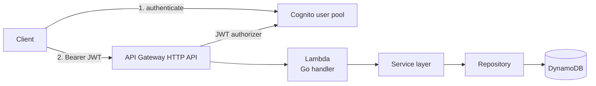

# Tasks API

A small serverless REST API for managing tasks, built with Go, AWS Lambda, API Gateway HTTP API and DynamoDB. It is a learning project focused on cloud-native backend development: layered Go code, DynamoDB access patterns, JWT authentication, least-privilege deployment identities, and spec-driven changes.

The project is intentionally small: one resource, one table, and no per-user ownership. It is a portfolio and learning project, not a production-ready service.

## What it demonstrates

- A Go service with explicit `handler`, `service`, and `repository` boundaries.
- AWS Lambda behind an API Gateway HTTP API (payload format v2).
- Cognito JWT authorization on every route.
- DynamoDB conditional writes and single-request updates, including the persisted result.
- Strict `PUT`/`PATCH` request semantics with unit and integration coverage.
- AWS SAM infrastructure and a scoped CloudFormation service role for deployments.
- OpenSpec specifications and archived change records for the API and deployment decisions.

## Architecture



The Lambda function is stateless; DynamoDB holds all task state. Authentication is enforced by the API Gateway JWT authorizer, not by application code.

## Stack

| Component | Choice |
|---|---|
| Language | Go 1.27 |
| Compute | AWS Lambda, `provided.al2023`, x86_64 |
| HTTP API | Amazon API Gateway HTTP API, payload format v2 |
| Data | Amazon DynamoDB, single table, partition key `id` |
| Auth | Amazon Cognito user pool and JWT authorizer |
| Infrastructure | AWS SAM (`template.yaml`) |
| Deployment identities | `infra/ci/template.yaml` bootstrap stack |
| Client collection | Bruno (`collection/`) |

The checked-in configuration targets `us-east-2`; adjust the region if you deploy elsewhere.

## Repository layout

```text
cmd/tasks-api/            Lambda entrypoint and dependency wiring
internal/handler/         HTTP routing, JSON parsing, status codes
internal/service/         Validation and ULID generation
internal/repository/      DynamoDB access
internal/model/           Task domain types
template.yaml             Application infrastructure (Lambda, API, table, authorizer)
infra/ci/template.yaml    Bootstrap: CloudFormation service role and CI deploy policy
scripts/local.sh          Reads the deployed table name and starts SAM Local
collection/               Bruno API collection
openspec/                 Specifications and archived change records
.github/workflows/ci.yml  Test, build and deploy workflow
```

## API

All routes require a Cognito access token:

```http
Authorization: Bearer YOUR_ACCESS_TOKEN
```

Use `YOUR_API_URL` as the base URL. Task IDs are ULIDs generated by the service.

| Method | Path | Success | Notes |
|---|---|---|---|
| `GET` | `/tasks` | `200` | Returns a JSON array; `[]` when empty |
| `POST` | `/tasks` | `201` | Creates a task and returns it with a `Location` header |
| `GET` | `/tasks/{id}` | `200` | `404` if the task does not exist |
| `PUT` | `/tasks/{id}` | `200` | Full replacement; requires all three fields |
| `PATCH` | `/tasks/{id}` | `200` | Partial update; requires at least one field |
| `DELETE` | `/tasks/{id}` | `204` | `404` if the task does not exist |

A task has this shape:

```json
{
  "id": "YOUR_TASK_ID",
  "title": "Write the README",
  "description": "Document the API contract",
  "completed": false
}
```

### Create a task

Export the JWT returned by Cognito as `ACCESS_TOKEN` before running the examples.

```bash
curl -X POST "YOUR_API_URL/tasks" \
  --oauth2-bearer "$ACCESS_TOKEN" \
  -H "Content-Type: application/json" \
  -d '{"title":"Write the README","description":"Document the API contract"}'
```

`POST` validates that `title` is not empty after trimming whitespace. `description` is optional, `completed` starts as `false`, and unknown fields are currently ignored.

### Update semantics

`PUT /tasks/{id}` replaces the whole task and requires `title`, `description`, and `completed`. An explicit `"completed": false` counts as present.

`PATCH /tasks/{id}` changes only the supplied fields and preserves the rest. At least one field is required.

Both operations reject unknown fields, `null` values, empty or whitespace-only bodies, non-object JSON, and trailing JSON values with `400`. Both return `200` with the task as persisted in DynamoDB, not a task reconstructed from the request.

```bash
curl -X PATCH "YOUR_API_URL/tasks/YOUR_TASK_ID" \
  --oauth2-bearer "$ACCESS_TOKEN" \
  -H "Content-Type: application/json" \
  -d '{"completed":true}'
```

### Errors

Errors use a JSON body:

```json
{"message":"Task not found"}
```

| Status | Meaning |
|---|---|
| `400` | Invalid JSON, invalid request shape, or validation failure |
| `401` | Missing or invalid JWT |
| `404` | Task not found |
| `500` | Unexpected server or DynamoDB error (generic message) |

`GET /tasks` performs a single DynamoDB `Scan`; it does not paginate. This is sufficient for the project's size but is not intended for large tables.

## Authentication

Cognito is created outside this repository. The HTTP API validates tokens with this configuration in `template.yaml`:

```yaml
Globals:
  HttpApi:
    Auth:
      DefaultAuthorizer: CognitoAuthorizer
      Authorizers:
        CognitoAuthorizer:
          IdentitySource: "$request.header.Authorization"
          JwtConfiguration:
            issuer: "https://cognito-idp.YOUR_AWS_REGION.amazonaws.com/YOUR_COGNITO_POOL_ID"
            audience:
              - "YOUR_COGNITO_CLIENT_ID"
```

The checked-in `template.yaml` contains the original deployment's issuer and audience. For a new deployment, create your own user pool and app client and update those values. Parameterizing them is a future improvement. Do not commit client secrets or user credentials.

### Bruno collection

The collection includes requests for login, token refresh, CRUD operations, and a partial update. To use it:

```bash
cp collection/environments/dev.yml collection/environments/dev.local.yml
```

In the copy, set `name` to `dev.local` and fill in `baseUrl`, `region`, `clientId`, `taskId`, `username`, and `password`. Select the `dev.local` environment in Bruno. The file matches the ignored `collection/environments/*.local.yml` pattern and must not be committed.

Run `auth/Login` first; it stores `accessToken` and `refreshToken` for the other requests. After creating a task, set `taskId` to the returned id before using the requests that target a specific task. `auth/Refresh Token` uses the stored refresh token to obtain a new access token.

## Local development

Requirements:

- Go 1.27.x
- AWS CLI v2
- AWS SAM CLI
- `make`
- Docker (for SAM Local)
- An AWS account with the deployed stack and credentials available through `AWS_PROFILE`

Optional: Bruno for the API collection, and Node `24.22.0` plus OpenSpec CLI `1.14.2` for working with the specs.

```bash
make build    # sam build
make test     # go test ./...
make local    # sam local start-api against the deployed table
make deploy   # sam build && sam deploy
```

`make deploy` builds first, then deploys with the profile in `AWS_PROFILE`. The default is `default`; override it without editing the Makefile:

```bash
AWS_PROFILE=your-profile make deploy
```

`make local` uses `scripts/local.sh`. The script reads the `TasksTableName` output from the deployed `tasks-api` stack, writes a temporary `env.json`, and starts SAM Local. It exits with a clear error if the stack or output is missing. The same `AWS_PROFILE` is inherited by both the script and SAM Local. SAM Local runs the handler locally; the Cognito authorizer belongs to the deployed HTTP API, so use the deployed endpoint or the Bruno collection for authenticated requests.

## Testing

Unit tests do not need AWS credentials:

```bash
make test
go test ./...
```

Race detection and coverage:

```bash
go test -race -cover ./...
```

Point-in-time coverage from a local run:

| Package | Statement coverage |
|---|---|
| `internal/handler` | 89.1% |
| `internal/service` | 100.0% |
| `internal/repository` | 54.3% (unit tests; integration tests excluded) |
| `cmd/tasks-api`, `internal/model` | 0.0% (no dedicated tests) |

These numbers are a snapshot, not a quality guarantee. The repository package has additional coverage in the integration suite.

### Integration tests

Repository integration tests run against a real DynamoDB table and are behind the `integration` build tag:

```bash
AWS_PROFILE=YOUR_AWS_PROFILE \
AWS_DEFAULT_REGION=YOUR_AWS_REGION \
TASKS_TABLE_NAME=YOUR_TASKS_TABLE_NAME \
go test -tags=integration -count=1 ./internal/repository/...
```

The suite creates, updates, and deletes tasks. **Never point it at the application table.** Create a dedicated table first:

```bash
aws dynamodb create-table --table-name YOUR_TASKS_TABLE_NAME \
  --attribute-definitions AttributeName=id,AttributeType=S \
  --key-schema AttributeName=id,KeyType=HASH \
  --billing-mode PAY_PER_REQUEST --region YOUR_AWS_REGION --profile YOUR_AWS_PROFILE
```

The test run neither creates nor deletes the table. `make test` excludes integration tests.

## Deployment

The application stack is defined in `template.yaml`. Deployment identities are in `infra/ci/template.yaml`, which is a separate bootstrap stack because the CloudFormation service role must exist before it can operate the application stack.

Prerequisites and bootstrap dependencies:

1. An AWS account, AWS CLI v2, and AWS SAM CLI.
2. A Cognito user pool and app client. Cognito is not provisioned by this repository.
3. A GitHub OIDC provider and the `GitHubActionsTasksApiRole` role. These are configured outside this repository.
4. The SAM-managed artifact bucket (`aws-sam-cli-managed-default-*`). SAM creates it on first use; it is not recreated automatically if deleted.
5. The `tasks-api-ci` bootstrap stack, deployed once by an authorized administrator:

```bash
aws cloudformation deploy --stack-name tasks-api-ci \
  --template-file infra/ci/template.yaml \
  --capabilities CAPABILITY_NAMED_IAM \
  --region YOUR_AWS_REGION \
  --profile YOUR_ADMIN_PROFILE
```

Updating `tasks-api-ci` requires `iam:PutRolePolicy` on `TasksApiCloudFormationServiceRole`. Do not assume your default profile has that permission; verify your caller identity first.

6. A deploy configuration based on `samconfig.toml.example`:

```bash
cp samconfig.toml.example samconfig.toml
```

Replace `YOUR_AWS_REGION` and `YOUR_ACCOUNT_ID`. The `role_arn` must reference the service role created by the bootstrap stack. The example is a template, not a ready-to-deploy configuration.

7. Build and deploy:

```bash
make deploy
```

The checked-in `samconfig.toml` retains the original deployment's role ARN. Treat it as environment-specific. If you want to keep account-specific values out of Git, use a local copy and pass it explicitly with `sam deploy --config-file`. `samconfig.local.toml` is ignored.

### CI workflow

`.github/workflows/ci.yml` runs tests and a build on pull requests and pushes to `main`. On a push to `main`, it assumes `GitHubActionsTasksApiRole` through GitHub OIDC and runs `sam deploy --no-confirm-changeset`; no static AWS keys are stored in GitHub.

The workflow does not create the OIDC provider, the GitHub role, the Cognito pool, or the bootstrap stack. Those are manual bootstrap steps.

### Deployment limitations

This repository is not fully reproducible from a fresh account without manual edits:

- `infra/ci/template.yaml` contains physical resource identifiers from the original deployment. Update them for a new account before bootstrapping; parameterization is a pending improvement.
- `template.yaml` contains the original Cognito issuer and audience. Create your own pool/client and update those values.
- `samconfig.toml` contains the original service role ARN. Start from `samconfig.toml.example` for a new environment.
- Cognito, the GitHub OIDC provider, the GitHub deploy role, and the SAM artifact bucket are bootstrap dependencies outside the versioned application stack.
- Documentation and examples use placeholders. Some functional files and historical commits still contain the original deployment's infrastructure identifiers; those are intentionally not rewritten in this phase.
- IAM and CI could be further hardened: the service role trust policy does not currently restrict `aws:SourceAccount`/`aws:SourceArn`, the workflow grants `id-token: write` at the workflow level, and branch protection, environment protection, concurrency controls, SHA-pinned actions, CodeQL, and Dependabot are not configured.

## OpenSpec

The source of truth for update semantics is [`task-management`](openspec/specs/task-management/spec.md). Deployment identity requirements are documented in [`deployment-security`](openspec/specs/deployment-security/spec.md).

Archived changes preserve the reasoning and verification history:

- [`harden-ci-deploy`](openspec/changes/archive/2026-10-20-harden-ci-deploy/proposal.md): replace `PowerUserAccess` with a scoped CI policy and a CloudFormation service role.
- [`fix-service-role-apigateway-actions`](openspec/changes/archive/2026-10-21-fix-service-role-apigateway-actions/proposal.md): correct API Gateway IAM action names and recover from the failed deployment.
- [`task-update-semantics`](openspec/changes/archive/2026-10-21-task-update-semantics/proposal.md): define strict `PUT` and partial `PATCH` behavior.

Validate the specs and changes with:

```bash
openspec validate --all --strict
openspec validate --archived --strict
```

The OpenSpec CLI is optional for building and deploying the application.

## Known limitations

- Tasks are global; there is no per-user ownership or tenant isolation.
- `GET /tasks` uses one DynamoDB `Scan` and does not paginate.
- `POST` ignores unknown fields and validates only `title`; `PUT` and `PATCH` are strict.
- Cognito and DynamoDB hardening (MFA, point-in-time recovery, deletion protection, log retention, tracing) is not part of the current application template.
- The deployment relies on manual bootstrap steps and contains original physical identifiers in functional templates, as described above.
- The project is a learning exercise, not a production-ready API.

## License

MIT. See [LICENSE](LICENSE).
